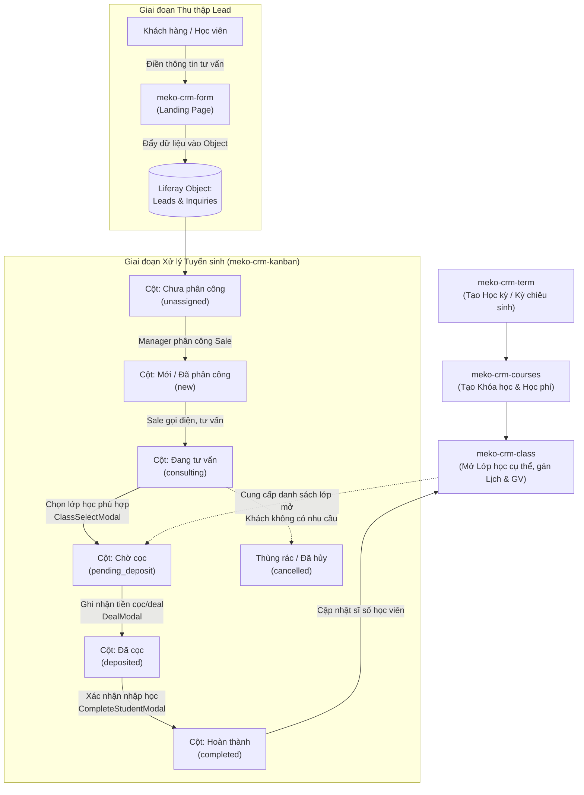

# Hệ Thống Kiến Trúc & Vai Trò Các Component Meko CRM (`meko-crm-*`)

Hệ thống **Meko CRM** được xây dựng dưới dạng các **Liferay Client Extensions (Custom Elements)** kết hợp với công nghệ **React + TypeScript + Tailwind CSS**. Mỗi component đảm nhiệm một phân hệ nghiệp vụ chuyên biệt nhưng liên kết chặt chẽ với nhau thông qua Liferay Objects (Leads, Inquiries, Classes, Courses, Terms).

---

## 1. Tổng Quan Vai Trò Các Component

| STT | Component | Tên nghiệp vụ | Vai trò & Trách nhiệm chính | Đối tượng sử dụng |
| :--- | :--- | :--- | :--- | :--- |
| **1** | `meko-crm-form` | **Landing Page Đăng Ký** | Thu thập thông tin khách hàng tiềm năng (Leads) qua form tư vấn / đăng ký khóa học công khai. | Khách hàng vãng lai, Học viên mới |
| **2** | `meko-crm-kanban` | **Kanban Pipeline Tuyển Sinh** | Quản lý quy trình xử lý học viên từ khi tiếp nhận đến khi chốt lớp/hoàn thành hoặc hủy. | Sale (Tư vấn viên), Manager (Quản lý) |
| **3** | `meko-crm-term` | **Quản Lý Học Kỳ (Terms)** | Thiết lập niên khóa, kỳ học, các đợt chiêu sinh trong năm và giám sát tiến độ tuyển sinh. | Academic Manager, Quản lý đào tạo |
| **4** | `meko-crm-courses` | **Quản Lý Khóa Học (Courses)** | Thiết lập danh mục khóa học, định mức học phí, khung chương trình đào tạo và lộ trình học. | Academic Manager, Ban giám đốc |
| **5** | `meko-crm-class` | **Quản Lý Lớp Học (Classes)** | Quản lý việc mở lớp, xếp phòng học, ca học/lịch học, giảng viên phụ trách và theo dõi sĩ số thực tế. | Giáo vụ, Quản lý đào tạo, Sale |
| **6** | `meko-crm-portal` | **Cổng Điều Hướng Trung Tâm** | Hub tổng quan điều hướng người dùng nội bộ tới các ứng dụng con trong hệ sinh thái CRM. | Toàn bộ nhân viên, Admin |

---

## 2. Chi Tiết Từng Phân Hệ Nghiệp Vụ

### 2.1. `meko-crm-form` (Landing Page & Form Thu Thập Lead)
- **Mục tiêu**: Kênh tiếp nhận khách hàng đầu vào (Top of Funnel).
- **Tính chất**: Public (không yêu cầu đăng nhập Liferay), giao diện thân thiện với người dùng cuối trên Web & Mobile.
- **Chức năng chính**:
  - Cung cấp form đăng ký nhận tư vấn: Họ tên, Số điện thoại, Email, Khóa học mong muốn (IELTS, TOEIC, Giao tiếp...), Nhu cầu/mục tiêu đầu ra, Ghi chú thêm.
  - Tích hợp kiểm tra tính hợp lệ dữ liệu (validation SĐT, email).
  - Tự động gọi API đẩy bản ghi vào đối tượng `Leads` và `Inquiries` trên Liferay Object.
- **Đầu ra**: Tạo mới bản ghi Lead với trạng thái ban đầu: `unassigned` (Chưa phân công).

---

### 2.2. `meko-crm-kanban` (Trung Tâm Quản Lý Vòng Đời Học Viên / Sales Pipeline)
- **Mục tiêu**: Trục điều phối cốt lõi dành cho đội ngũ Tuyển sinh (Sales) và Trưởng phòng (Manager).
- **Phân quyền người dùng**:
  - **Manager (Quản lý)**: Toàn quyền xem toàn bộ Lead; phân công hoặc chỉ định tư vấn viên (`AssignModal`); duyệt hủy hoặc khôi phục Lead.
  - **Sale (Tư vấn viên)**: Xem danh sách Lead được giao cho mình; cập nhật tiến độ tư vấn, chọn lớp học và ghi nhận tiền cọc/học phí.
- **Quy trình luân chuyển trạng thái (Pipeline Stages)**:
  1. `unassigned` (**Chưa phân công**): Lead mới đẩy từ `meko-crm-form` vào, chờ Manager gán cho Sale.
  2. `new` (**Mới / Đã phân công**): Đã gán cho tư vấn viên phụ trách, chuẩn bị liên hệ.
  3. `consulting` (**Đang tư vấn**): Sale đang trao đổi với học viên về lộ trình và nhu cầu.
  4. `pending_deposit` (**Chờ cọc**): Học viên đã chọn được lớp học phù hợp (`ClassSelectModal`), chờ chuyển khoản cọc.
  5. `deposited` (**Đã cọc**): Học viên đã thanh toán một phần hoặc toàn bộ (`DealModal`), giữ chỗ trong lớp.
  6. `completed` (**Hoàn thành**): Xác nhận học viên chính thức nhập học vào lớp (`CompleteStudentModal`), kết thúc phễu tuyển sinh.
  7. `cancelled` / **Thùng rác**: Khách hàng không có nhu cầu, sai thông tin hoặc hủy giao dịch.
- **Các Modal & Tiện ích đi kèm**:
  - `CardDetailDrawer`: Xem lịch sử liên hệ, thông tin chi tiết và ghi chú chăm sóc.
  - `AssignModal`: Phân bổ Lead cho tư vấn viên.
  - `ClassSelectModal`: Xem danh sách lớp học khả dụng và gắn lớp cho học viên.
  - `DealModal`: Ghi nhận mã Deal, số tiền đặt cọc/học phí.
  - `CompleteStudentModal`: Hoàn tất hồ sơ nhập học.

---

### 2.3. `meko-crm-term` (Quản Lý Học Kỳ & Đợt Tuyển Sinh)
- **Mục tiêu**: Định nghĩa các mốc thời gian và kỳ tuyển sinh chiến lược trong năm tài chính/năm học.
- **Chức năng chính**:
  - Danh sách học kỳ theo niên khóa (VD: `TERM-2025-01`, `Kỳ Xuân 2025`, `Kỳ Hè 2025`).
  - Thiết lập ngày bắt đầu, ngày kết thúc, hạn chót nhận đăng ký.
  - Trạng thái kỳ học:
    - `UPCOMING` (**Đang chiêu sinh**): Đang mở cổng tuyển sinh cho kỳ mới.
    - `ONGOING` (**Đang diễn ra**): Kỳ học đang được giảng dạy.
    - `FINISHED` (**Đã kết thúc**): Kỳ học đã bế giảng, khóa dữ liệu.
  - Thanh đo lường tiến độ tuyển sinh (% đạt chỉ tiêu học viên theo từng kỳ).
  - Form thêm mới/chỉnh sửa thông tin học kỳ (`TermForm`).

---

### 2.4. `meko-crm-courses` (Quản Lý Khóa Học & Chương Trình Đào Tạo)
- **Mục tiêu**: Chuẩn hóa danh mục sản phẩm giáo dục của trung tâm.
- **Chức năng chính**:
  - Danh sách khóa học dạng Card trực quan (`CourseCard`, `CourseCardHeader`, `CourseCardBody`).
  - Thông tin khóa học: Mã khóa (`IELTS-65`, `TOEIC-700`), Tên khóa, Thời lượng (số buổi học), Định mức học phí tiêu chuẩn, Giảng viên phụ trách chương trình.
  - Thống kê nhanh: Số lượng lớp đang mở (`openClasses`), trạng thái đủ học viên (`isFull`).
  - Phân loại trạng thái: `ACTIVE` (Đang triển khai), `UPCOMING` (Sắp mở), `CLOSED` (Tạm ngưng/Đóng).

---

### 2.5. `meko-crm-class` (Quản Lý Lớp Học & Phân Phối Học Viên)
- **Mục tiêu**: Điều phối lớp học thực tế và là điểm tiếp nhận học viên sau khi kết thúc phễu Kanban.
- **Chức năng chính**:
  - Tổ chức danh sách lớp theo từng Khóa học (`Course`) và Kỳ học (`Term`).
  - Quản lý thông tin chi tiết: Lịch học (ca học, ngày học trong tuần: 2-4-6, 3-5-7), Phòng học, Giảng viên đứng lớp.
  - Quản lý sĩ số: Số học viên đã đăng ký / Số lượng chỗ tối đa (Capacity).
  - Kết nối trực tiếp với `meko-crm-kanban` để cập nhật danh sách học viên khi Sale chốt lớp.

---

### 2.6. `meko-crm-portal` (Cổng Tổng Quan / Application Hub)
- **Mục tiêu**: Giao diện tập trung dành cho nhân viên nội bộ truy cập nhanh vào tất cả các phân hệ CRM.
- **Chức năng chính**:
  - Dashboard điều hướng (`APPS_DATA`): Phím tắt điều hướng nhanh tới Form, Kanban, Courses, Class, Term.
  - Cung cấp giao diện đồng bộ nhận diện thương hiệu Meko CRM.

---

## 3. Luồng Nghiệp Vụ Xuyên Suốt (End-to-End Workflow)

---

## 4. Các Thành Phần Hỗ Trợ (Auxiliary Modules)

- `crm-kanban-widget`: Tệp cấu hình Liferay Client Extension (Custom Element) để nhúng React app vào layout trang portal của Liferay DXP.
- `crm-objects-batch`: Định nghĩa các lược đồ thực thể (Data Schemas) của Liferay Objects dùng cho việc deploy hàng loạt (`Lead`, `Inquiry`, `Clazz`, `Course`, `Term`).
- `common`: Chứa các tài nguyên dùng chung giữa các client extensions (utilities, styles, base configurations).
